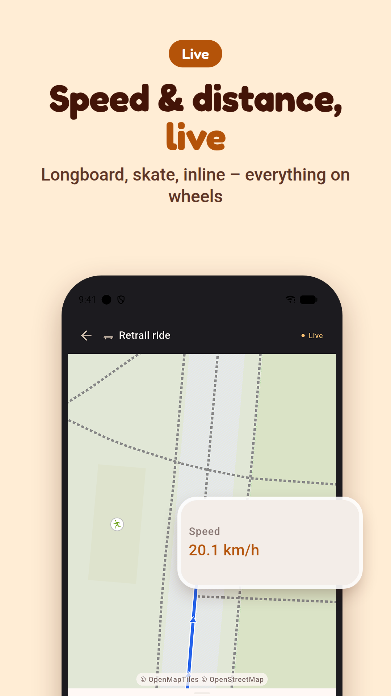
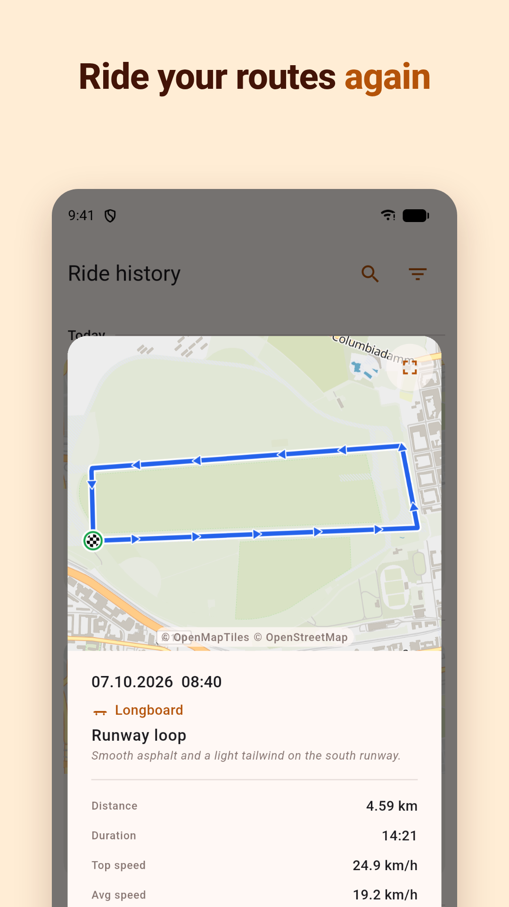
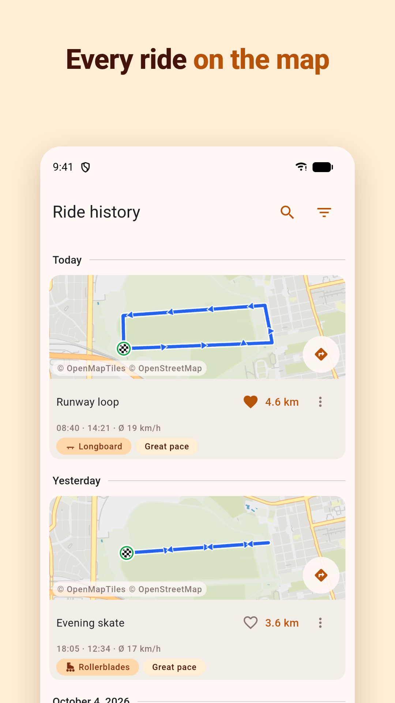
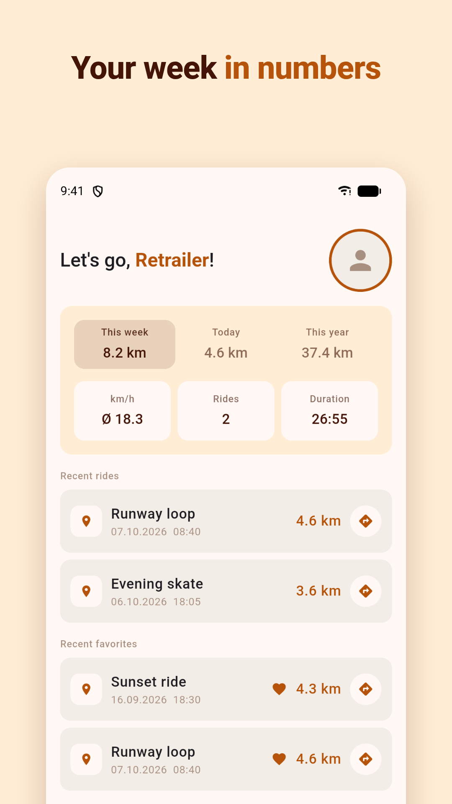

# Retrail

**The GPS tracker for everything on wheels.** Retrail records longboard, skateboard, inline-skate and
roller-skate rides (route, speed, distance) and keeps them on your phone. It has no account, no ads
and no tracking.

Retrail is a Flutter app for **Android and iOS**.

<p align="center">
  
  
  
  
</p>

## Features

### Record a ride
- Pick an activity: **Longboard, Skateboard, Inline skates, Roller skates, Mountainboard, Scooter** or
  **Other**.
- A live map with your route, a speedometer-style speed display, distance, duration and top speed.
- Pause and resume at any time. Recording continues with the screen off, controlled from the
  notification (Android) or a **Live Activity** on the lock screen and in the Dynamic Island (iOS).
- Recording works without mobile data.

### Follow a saved route
- Ride a saved route again with your live position on top of it.
- Ride it **forwards or backwards**. Retrail detects the direction.
- See how far you still have to go, and get a notice when you leave the route.
- Record the repeat ride, or just follow it.

### Ride history
- Each ride has a map preview, distance, duration and speeds.
- Search, filter by year, month and activity, mark favourites.
- Rename rides, add notes, navigate to a ride's start point.
- The home screen shows your kilometres for this week, today and this year.

Light and dark theme, in English and German.

## Tech stack

Flutter (Material 3) · Riverpod · Drift (SQLite) · MapLibre with [OpenFreeMap](https://openfreemap.org)
vector tiles · `geolocator` + `flutter_foreground_task` for background GPS · ActivityKit Live Activity
on iOS

## Running it

Requires Flutter stable (Dart ≥ 3.12). No API keys or config files are needed.

```bash
flutter pub get
flutter run
flutter test
```

Architecture, conventions and the development workflow are described in [`CLAUDE.md`](CLAUDE.md).
The per-feature specs are in [`docs/specs/`](docs/specs), and the release and iOS sideloading guides
are in [`docs/`](docs).

## Privacy

Rides, routes and the profile stay on the device. Retrail has no backend. Network access is only used
for map tiles from OpenFreeMap and a small connectivity check. See the
[privacy policy](https://valijuu.github.io/Retrail/privacy/).

Map data © [OpenStreetMap](https://www.openstreetmap.org/copyright) contributors, tiles by
[OpenFreeMap](https://openfreemap.org).

## License

**All rights reserved.** © 2026 Valeri Justus. The repository is public for viewing only. See
[`LICENSE`](LICENSE).
